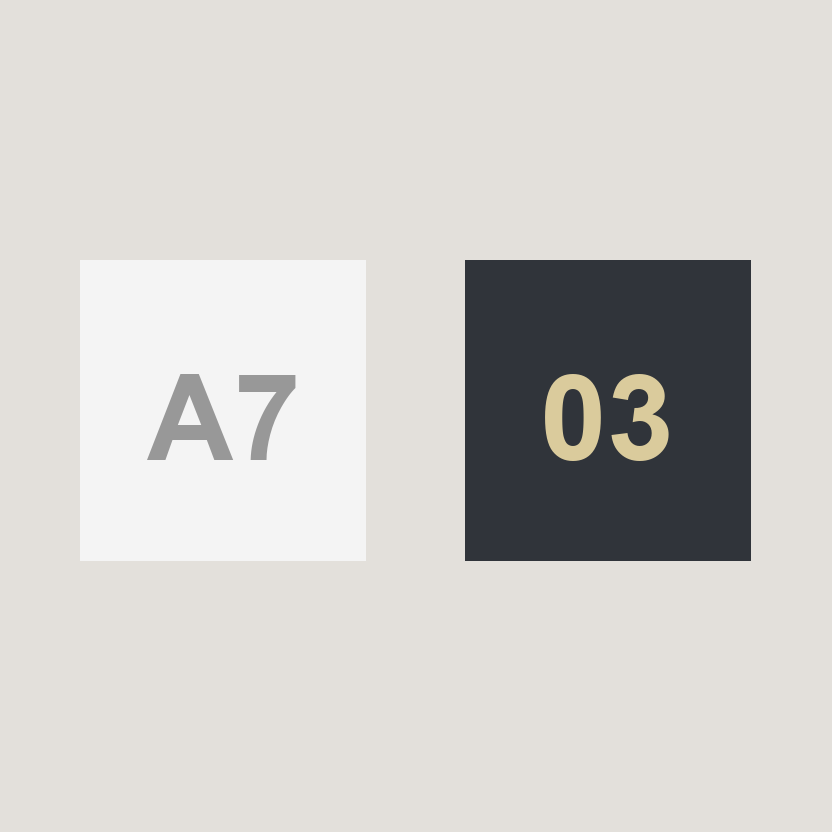
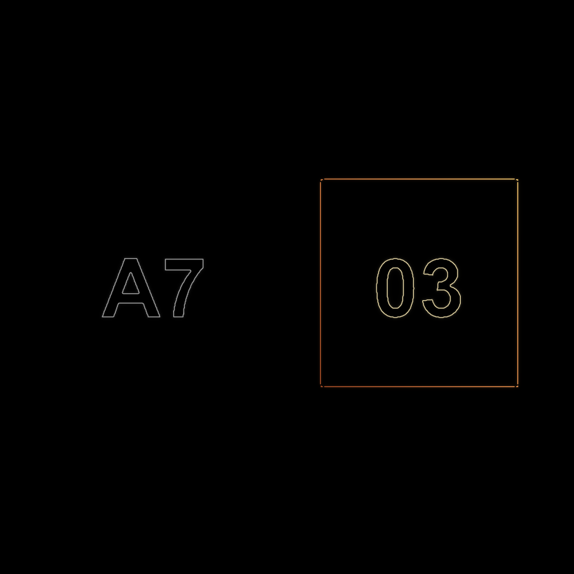

# 二次元图片转彩色线稿 v4.3

上传一张二次元底图，在 ComfyUI 生成黑底彩色线稿 PNG。人物的长相、朝向、表情和刻字来自底图。可以自定主线的暗色、亮色，并为两处纹身或刻字分别保留原色或指定轮廓色。

默认 `edges` 使用本机 OpenCV，CPU 和空模型目录即可运行。底图轮廓清楚、背景简单，出线更干净。绘画提示词可用来准备底图，已有插画可以直接用。[手动操作和配色指南](GUIDE_COLOR_LINEART.md) · [AI 接入说明](AI_INTEGRATION.md)

## 样图

灰色 `A7` 和浅金色 `03` 各自保留原色轮廓。可以用随包底图和同一组参数复现。[练习参数](examples/profile_lineart_pale_settings.json)

| 练习底图 | 彩色线稿 |
| --- | --- |
|  |  |

## 安装

用目标 ComfyUI 的 Python 执行以下两条命令。将 `D:\ComfyUI` 换成含有 `main.py` 的程序目录，再重启 ComfyUI。Windows 便携版的 Python 通常在 `python_embeded\python.exe`。如果启动 ComfyUI 时另设了 `--base-directory`，安装时也传入相同目录。

```powershell
python -m pip install -r .\requirements.txt
python -X utf8 .\prepare_image_workflow.py --comfy-dir 'D:\ComfyUI'
```

两条命令都在解压后的项目根目录运行。ComfyUI 自带 PyTorch、NumPy 和 Pillow，额外依赖是 OpenCV。如果目标 Python 已有可用的 `cv2`，可以直接执行第二条命令。验证版本为 ComfyUI 0.34.0。

## 出第一张图

1. 在 ComfyUI 的「工作流」列表打开 **ProfileLineart_Color_Lineart_v4_3**。首次运行可以直接用安装时提供的双刻字练习图。
2. 在「上传二次元底图」选择你的 PNG、JPEG 或 WebP。节点 **20** 保持 `edges`、`detail=0.50` 和开启的 `contrast_recovery`。
3. 在 **90／91** 选主线的暗色和亮色。纹身或刻字可用下方的记号 A、B 单独处理。淡金、灰色记号选 `region_sample`，填写所在范围和底图取样色。用 `original` 保留原色，或用 `custom` 指定成品色。
4. 点「运行」。在 **29** 看白线，**125／135** 看两处记号轮廓。成品保存在 ComfyUI 的 `output/profile_lineart/color_lineart_v4_3/`，文件名以 `final` 开头。

图片过淡时，`contrast_recovery` 会在白线接近空白时自动增强一次反差。仍找不到轮廓时会提示调整 `detail` 或换图。透明区以白底处理，动画图片取第一帧。

可选的 `anime_model` 会用 Anime Lineart 模型从这张二次元底图提线，需安装 [comfyui_controlnet_aux](https://github.com/Fannovel16/comfyui_controlnet_aux) 及其 Anime Lineart 权重 `netG.pth`。使用默认的 `edges` 时可以跳过这项。

[ComfyUI 界面模板](workflows/ProfileLineart_Color_Lineart_v4_3.json) · [双刻字练习图](examples/profile_lineart_practice.png) · [浅色刻字练习图](examples/profile_lineart_pale_marks.png)

## 验证

用 ComfyUI 的 Python 在项目根目录运行 `python -m unittest discover -s tests -v`。测试使用包内图片，检查正常图、低反差恢复、空白提示和两处浅色轮廓。
